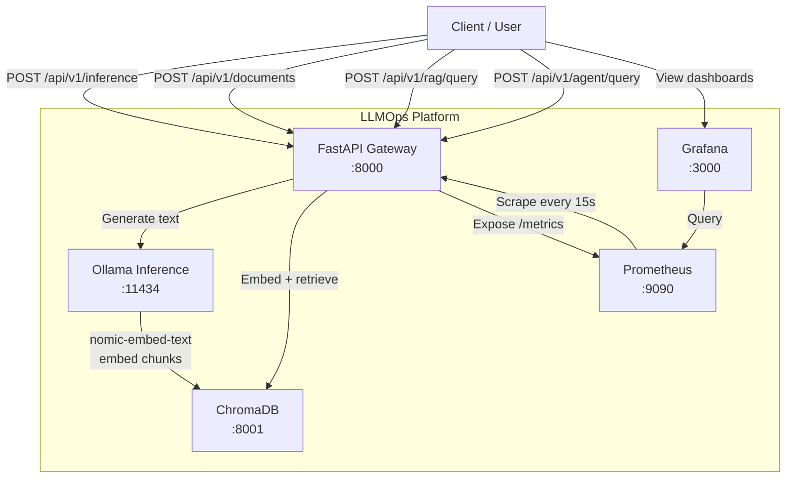

# LLMOps Platform

A self-hosted, production-oriented LLM serving and RAG platform built with Ollama, FastAPI,
ChromaDB, Prometheus, and Grafana. Deployable locally with Docker Compose or on any Kubernetes
cluster (Minikube, k3d, GKE, EKS, etc.) via Helm.

---

## Architecture



---

## Technology Stack

| Component | Technology |
|-----------|-----------|
| LLM inference | Ollama + Qwen 2.5 3B |
| Embedding model | Ollama + nomic-embed-text |
| API gateway | FastAPI + Uvicorn |
| RAG orchestration | LangChain |
| Vector database | ChromaDB |
| Agentic AI | LangGraph |
| Containerisation | Docker + Docker Compose |
| Orchestration | Kubernetes + Helm |
| Metrics | Prometheus |
| Dashboards | Grafana |

---

## Prerequisites

- **Docker** ≥ 24 and **Docker Compose** V2
- **8–16 GB RAM** (Qwen 2.5 3B uses ~3–4 GB on CPU)
- **~5 GB free disk** (models are downloaded on first start)
- For Kubernetes: **kubectl** ≥ 1.28, **Helm** ≥ 3.14, and a local cluster (Minikube / k3d)

---

## Local Setup (no Docker)

```bash
git clone <repo-url> llmops-platform
cd llmops-platform

# Create virtual environment
python -m venv .venv && source .venv/bin/activate
pip install -r requirements.txt

# Install and start Ollama locally
curl -fsSL https://ollama.ai/install.sh | sh
ollama serve &
ollama pull qwen2.5:3b
ollama pull nomic-embed-text

# Start ChromaDB (requires Docker or pip install chromadb[server])
docker run -d -p 8001:8000 chromadb/chroma:0.5.23

# Configure environment
cp .env.example .env
# Edit .env: set OLLAMA_HOST=http://localhost:11434, CHROMA_HOST=localhost, CHROMA_PORT=8001

# Run the API
uvicorn app.main:app --host 0.0.0.0 --port 8000 --reload
```

---

## Docker Compose Deployment

```bash
cp .env.example .env          # review and adjust if needed
docker compose up -d          # starts Ollama, ChromaDB, FastAPI, Prometheus, Grafana
```

**First run note:** Ollama downloads `qwen2.5:3b` (~2 GB) and `nomic-embed-text` (~270 MB)
before the health check passes. Allow 5–15 minutes depending on your connection. Subsequent
starts are instant because models are persisted in a named Docker volume.

Check status:

```bash
docker compose ps
docker compose logs -f ollama   # watch model download progress
```

Stop everything:

```bash
docker compose down             # keeps volumes (models + vector data)
docker compose down -v          # also removes volumes (full reset)
```

---

## API Endpoints

Base URL: `http://localhost:8000`

### Health

```bash
GET /health
```

```json
{"status": "healthy", "ollama": "up", "version": "1.0.0"}
```

### Prometheus metrics

```bash
GET /metrics
```

### List available models

```bash
GET /api/v1/models
```

### Generate (inference)

```bash
POST /api/v1/inference
Content-Type: application/json

{
  "prompt": "Explain what a transformer model is in two sentences.",
  "model": "qwen2.5:3b",          # optional — defaults to configured model
  "system": "You are a helpful assistant.",  # optional system prompt
  "temperature": 0.7,
  "max_tokens": 512
}
```

Response:

```json
{
  "text": "...",
  "model": "qwen2.5:3b",
  "tokens_generated": 48,
  "prompt_tokens": 22,
  "duration_seconds": 4.1,
  "tokens_per_second": 11.7
}
```

### Upload a PDF document

```bash
POST /api/v1/documents
Content-Type: multipart/form-data

curl -F "file=@/path/to/report.pdf" http://localhost:8000/api/v1/documents
```

Response:

```json
{
  "message": "Document indexed successfully",
  "filename": "report.pdf",
  "pages": 12,
  "chunks": 47
}
```

### RAG query

```bash
POST /api/v1/rag/query
Content-Type: application/json

{
  "question": "What were the key findings in the report?",
  "top_k": 4
}
```

Response:

```json
{
  "answer": "According to [Source: report.pdf, Page: 3], ...",
  "sources": [{"filename": "report.pdf", "page": 3}],
  "context_used": true,
  "chunks_retrieved": 4,
  "duration_seconds": 5.2
}
```

### Agent query

```bash
POST /api/v1/agent/query
Content-Type: application/json

{"query": "What does the document say about budget? Also calculate 1.5 * 1200000."}
```

Response:

```json
{
  "answer": "The document mentions a budget of $1.2M. 1.5 × 1,200,000 = 1,800,000.",
  "tools_used": ["search_documents", "calculate"],
  "steps": 5
}
```

---

## RAG Workflow

1. **Upload** — PDF bytes are extracted page-by-page with PyPDF.
2. **Chunk** — `RecursiveCharacterTextSplitter` splits text into 1,000-token chunks with 200-token
   overlap to preserve context across boundaries.
3. **Embed** — Ollama's `nomic-embed-text` model converts each chunk into a dense vector.
4. **Store** — Vectors and their source metadata (filename, page) are persisted in ChromaDB.
5. **Retrieve** — At query time, the user question is embedded and compared against all stored
   vectors; the top-k most similar chunks are returned.
6. **Generate** — The retrieved chunks are injected into a prompt along with the system instruction
   to answer only from provided context. Qwen 2.5 3B generates the final answer.
7. **Cite** — Every response includes the source filename and page number for each retrieved chunk.

---

## Prometheus & Grafana

| URL | Service |
|-----|---------|
| `http://localhost:9090` | Prometheus |
| `http://localhost:3000` | Grafana (admin / admin by default) |

The Prometheus data source and the **LLMOps Platform** dashboard are provisioned automatically
on first Grafana start. No manual setup is required.

Dashboard panels:

- Inference requests per minute (total / success / error)
- Request latency P50 and P95
- Error rate %
- Token generation speed (tokens/min)
- Ollama availability indicator
- Total inference requests (stat)
- Documents indexed (stat)
- RAG requests per minute
- RAG latency P50 and P95

> **Monitoring screenshots:** *(add after running the stack)*

---

## Kubernetes Deployment

### Prerequisites

```bash
# Start a local cluster (choose one)
minikube start --memory 10240 --cpus 4
# OR
k3d cluster create llmops --agents 1 --memory 10g
```

### Apply raw manifests

```bash
kubectl apply -f kubernetes/manifests/namespace.yaml
kubectl apply -f kubernetes/manifests/configmap.yaml
kubectl apply -f kubernetes/manifests/secret.yaml
kubectl apply -f kubernetes/manifests/pvcs.yaml
kubectl apply -f kubernetes/manifests/ollama.yaml
kubectl apply -f kubernetes/manifests/chromadb.yaml
kubectl apply -f kubernetes/manifests/fastapi.yaml
```

> **Note:** The Ollama init container downloads both models on first deployment. This may take
> 10–20 minutes on a slow connection. Watch progress with:
> `kubectl logs -n llmops -l app=ollama -c pull-models -f`

Port-forward to test locally:

```bash
kubectl port-forward -n llmops svc/llmops-api 8000:8000
```

### Helm Installation

```bash
# Lint the chart first
helm lint helm/llmops/

# Install into the llmops namespace
helm install llmops helm/llmops/ --namespace llmops --create-namespace

# Or with overrides
helm install llmops helm/llmops/ \
  --namespace llmops --create-namespace \
  --set ollama.model=qwen2.5:7b \
  --set grafana.adminPassword=strongpassword

# Upgrade
helm upgrade llmops helm/llmops/ --namespace llmops

# Uninstall
helm uninstall llmops --namespace llmops
```

Build and load the API image into the local cluster before installing:

```bash
docker build -f docker/Dockerfile -t llmops-api:latest .

# Minikube
minikube image load llmops-api:latest

# k3d
k3d image import llmops-api:latest -c llmops
```

---

## GPU Deployment

### CPU vs NVIDIA GPU inference

| | CPU | NVIDIA GPU |
|---|---|---|
| Tokens/sec (Qwen 2.5 3B) | ~8–15 | ~80–200+ |
| RAM required | 4–6 GB system RAM | 4–6 GB VRAM |
| Power | Low | High |
| Setup complexity | None | CUDA drivers + GPU Operator |

### Enabling GPU support

Ollama auto-detects NVIDIA GPUs via CUDA. No application code changes are needed.

**Docker Compose** — install the [NVIDIA Container Toolkit](https://docs.nvidia.com/datacenter/cloud-native/container-toolkit/install-guide.html)
and add to the `ollama` service in `docker-compose.yml`:

```yaml
deploy:
  resources:
    reservations:
      devices:
        - driver: nvidia
          count: 1
          capabilities: [gpu]
```

**Kubernetes** — install [NVIDIA GPU Operator](https://docs.nvidia.com/datacenter/cloud-native/gpu-operator/latest/getting-started.html)
on the cluster, then enable GPU scheduling in Helm:

```bash
helm install llmops helm/llmops/ \
  --set ollama.gpu.enabled=true \
  --set ollama.gpu.nodeSelector."accelerator"=nvidia-gpu
```

**GPU observability** — deploy [NVIDIA DCGM Exporter](https://github.com/NVIDIA/dcgm-exporter) and
add its scrape target to `monitoring/prometheus.yml`. DCGM provides SM utilisation, VRAM usage,
temperature, and power draw metrics. This project does not include DCGM configuration as it
requires compatible hardware that was not available during development.

---

## Running Tests

```bash
pip install -r requirements.txt
pytest tests/ -v
```

All tests mock external services (Ollama, ChromaDB) and run without a live stack.

---

## Known Limitations & Future Improvements

| Limitation | Notes |
|-----------|-------|
| CPU-only inference is slow | 8–15 tokens/sec on a laptop with Qwen 2.5 3B; GPU reduces this to <1 s |
| No authentication | The API has no auth layer; add OAuth2 / API keys for public deployments |
| ChromaDB single-node | ChromaDB does not support horizontal scaling in its embedded mode |
| No streaming | Inference responses are returned in full; streaming via SSE could be added |
| Agent reliability | Qwen 2.5 3B tool-use can be inconsistent; larger models are more reliable |
| No document management | There is no endpoint to delete or update indexed documents |
| Helm lacks Prometheus/Grafana | The chart deploys the app components only; use the kube-prometheus-stack chart for full observability in Kubernetes |
